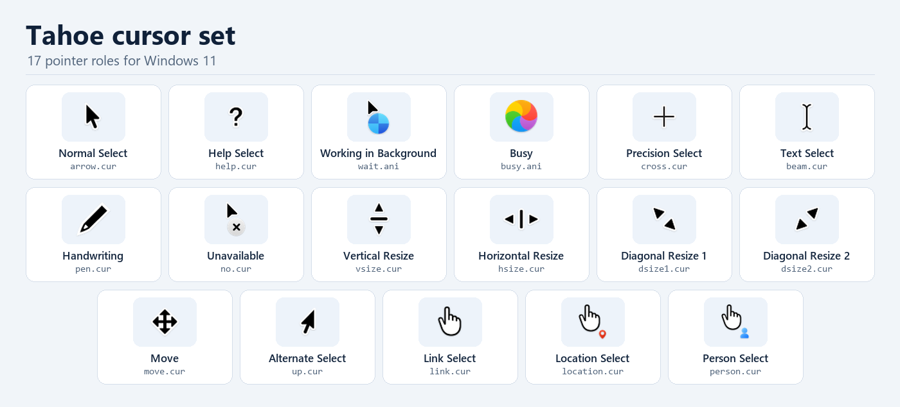

# macOS Tahoe Cursors for Windows 11

Install 17 macOS Tahoe pointers, including the animated **Busy** and **Working in Background** cursors. Setup runs offline for your Windows account and requires no administrator access.

**[Download ZIP](https://github.com/Squiggleshock/mactahoe-cursors-installer/archive/refs/heads/main.zip)** · [Install](#install) · [Restore](#restore-your-previous-pointers) · [Manual setup](#manual-setup)

## Cursor preview

| Working in Background | Busy |
| --- | --- |
|  |  |

Previews are enlarged from the bundled [cursor files](cursors/). The gallery shows one frame of each animated pointer.

## Install

Designed for **Windows 11 on x64 and Arm64**. The launcher uses the built-in Windows PowerShell 5.1. If Windows in S mode or your organization’s policies block the launcher, see [Manual setup](#manual-setup).

1. [Download the ZIP](https://github.com/Squiggleshock/mactahoe-cursors-installer/archive/refs/heads/main.zip) and extract the entire archive. Keep the `cursors` folder alongside the launchers and PowerShell script.
2. From the Windows account that will use the pointers, double-click [`Install.cmd`](Install.cmd).
3. Once the launcher reports success, the pointers are active. To see the saved scheme, press <kbd>Win</kbd> + <kbd>R</kbd>, enter `main.cpl`, and open the **Pointers** tab. The scheme is named **macOS Tahoe (Custom Cursors)**.

Windows uses the installed copy in `%LOCALAPPDATA%\TahoeCursors`. Keep the extracted folder or ZIP handy for reinstalling or restoring.

## Restore your previous pointers

Double-click [`Restore.cmd`](Restore.cmd) from the same Windows account. It reapplies the settings saved before installation and removes the sign-in shortcut. The copied cursor files remain in `%LOCALAPPDATA%\TahoeCursors`.

## If Windows resets the pointers

The installer adds **Restore Tahoe cursor scheme** to your Startup folder. At sign-in, it checks the active pointers and the saved scheme and reapplies the Tahoe settings if they have changed. Run `Restore.cmd` before switching to a different scheme you want to keep.

1. Press <kbd>Win</kbd> + <kbd>R</kbd>, enter `shell:startup`, and check for **Restore Tahoe cursor scheme**.
2. If the scheme still fails to apply, check `%LOCALAPPDATA%\TahoeCursors\sign-in-error.txt` if it exists.
3. Rerun `Install.cmd` to repair the shortcut or missing cursor files. Reinstalling keeps the original backup for `Restore.cmd`.

## Manual setup

1. Copy the bundled `cursors` folder to a permanent location in your Windows profile.
2. Press <kbd>Win</kbd> + <kbd>R</kbd>, enter `main.cpl`, and open the **Pointers** tab.
3. Select each role below, click **Browse**, and choose its cursor file.
4. Click **Save As** to name the scheme, then click **Apply**.

Manual setup saves the scheme through Windows. The automatic sign-in repair and `Restore.cmd` backup come from running the installer.

| Windows pointer role | File |
| --- | --- |
| Normal Select | `arrow.cur` |
| Help Select | `help.cur` |
| Working in Background | `wait.ani` |
| Busy | `busy.ani` |
| Precision Select | `cross.cur` |
| Text Select | `beam.cur` |
| Handwriting | `pen.cur` |
| Unavailable | `no.cur` |
| Vertical Resize | `vsize.cur` |
| Horizontal Resize | `hsize.cur` |
| Diagonal Resize 1 | `dsize1.cur` |
| Diagonal Resize 2 | `dsize2.cur` |
| Move | `move.cur` |
| Alternate Select | `up.cur` |
| Link Select | `link.cur` |
| Location Select | `location.cur` |
| Person Select | `person.cur` |

## Credits and license

KANO GAMING created the macOS Tahoe Cursor Set and released it into the public domain. See the [original credits](cursors/readme.txt) and [cursor mapping](cursors/macos-tahoe.crs).

The installer is licensed under the [GNU General Public License v3](LICENSE). Its source is in [`Install-TahoeCursors.ps1`](Install-TahoeCursors.ps1).
